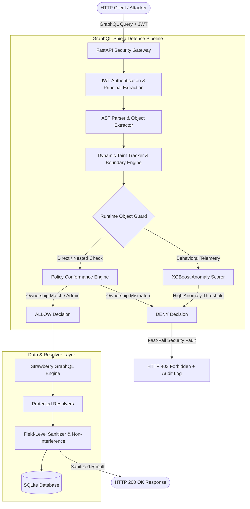

# 🛡️ GraphQL-Shield: Autonomous AST-Level Runtime Object Guard & Behavioral Defense Framework

[](https://www.python.org/)
[](https://fastapi.tiangolo.com)
[](https://strawberry.rocks/)
[]()
[](https://owasp.org/API-Security/editions/2023/en/0xa1-broken-object-level-authorization/)
[](https://opensource.org/licenses/MIT)

> **A dual-engine security framework providing AST-level deterministic object authorization, dynamic taint tracking, and XGBoost-driven behavioral anomaly detection to eliminate Broken Object Level Authorization (BOLA / IDOR) in GraphQL APIs.**

---

## 📑 Table of Contents

- [Overview & Motivation](#-overview--motivation)
- [Key Features](#-key-features)
- [Architecture & Threat Model](#-architecture--threat-model)
  - [1. AST Runtime Object Guard](#1-ast-runtime-object-guard)
  - [2. Dynamic Taint Tracking & Boundary Engine](#2-dynamic-taint-tracking--boundary-engine)
  - [3. Behavioral Machine Learning Engine (XGBoost)](#3-behavioral-machine-learning-engine-xgboost)
  - [4. Non-Interference & Field-Level Sanitization](#4-non-interference--field-level-sanitization)
- [Interactive Research & Security Dashboard](#-interactive-research--security-dashboard)
- [Quickstart Guide](#-quickstart-guide)
  - [Prerequisites](#prerequisites)
  - [Installation & Setup](#installation--setup)
  - [Running the Server](#running-the-server)
- [Live Interactive Attack Demonstrations](#-live-interactive-attack-demonstrations)
  - [Demo Personas](#demo-personas)
  - [Demo 1: Legitimate Resource Access (200 OK)](#demo-1-legitimate-resource-access)
  - [Demo 2: Direct Root BOLA Attack (403 Forbidden)](#demo-2-direct-root-bola-attack)
  - [Demo 3: Nested Object BOLA Attack (403 Forbidden)](#demo-3-nested-object-bola-attack)
  - [Demo 4: Implicit Relationship Traversal Probe](#demo-4-implicit-relationship-traversal-probe)
  - [Demo 5: Administrative Policy Override](#demo-5-administrative-policy-override)
- [Academic Research & Benchmarking Suite](#-academic-research--benchmarking-suite)
  - [Comparative Dual-Endpoint Architecture](#comparative-dual-endpoint-architecture)
  - [Executing Research Benchmarks](#executing-research-benchmarks)
  - [Training the Behavioral XGBoost Model](#training-the-behavioral-xgboost-model)
- [Verification & Test Suite](#-verification--test-suite)
- [API Reference](#-api-reference)
- [Directory Structure](#-directory-structure)
- [License](#-license)

---

## 🔍 Overview & Motivation

**Broken Object Level Authorization (BOLA / IDOR)** consistently ranks as the **#1 vulnerability in OWASP API Security Top 10 (API1:2023)**. 

While REST architectures feature rigid, predictable resource hierarchies (e.g. `/users/101/orders/501`), **GraphQL introduces unique, critical security challenges**:
1. **Dynamic Selection Sets & Unbounded Depth**: Clients construct custom queries with arbitrary nesting.
2. **Disconnected Resolvers**: Field-level resolvers execute independently; parent authorization checks rarely propagate automatically to child resolvers.
3. **Implicit Relationship Traversal**: Attackers traverse graph edges (e.g. `user -> organization -> projects -> sensitive_document`) to access foreign objects without specifying their IDs directly.
4. **Perimeter Blindness**: Traditional Web Application Firewalls (WAFs) and perimeter API Gateways cannot inspect deep GraphQL ASTs or establish ownership boundaries before database queries execute.

**GraphQL-Shield** addresses these challenges by embedding an autonomous **Runtime Object Guard directly into the execution lifecycle**. It combines formal AST traversal, dynamic data-flow taint tracking, and machine learning behavioral scoring to guarantee zero unauthorized data access while preserving legitimate query flexibility.

---

## ⚡ Key Features

- 🛡️ **Deterministic AST Runtime Object Guard**: Pre-execution AST inspection and argument extraction prevent unauthorized database fetches before resolvers are invoked.
- 🧬 **Dynamic Taint Tracking & Boundary Engine**: Models query arguments and path identifiers as taint sources, tracking propagation through graph edges with zero execution side-effects.
- 🌳 **Multi-Level BOLA Interception**:
  - **Direct Root BOLA**: Stops explicit ID tampering at root fields (`resource(id: 102)`).
  - **Nested Object BOLA**: Identifies unauthorized objects injected into deeply nested queries.
  - **Implicit Relationship BOLA**: Sanitizes child collections beneath authorized parent containers.
- 🤖 **Behavioral ML Anomaly Engine (XGBoost)**: Analyzes request velocity, path entropy, traversal patterns, and role-distance vectors to detect automated ID harvesting and zero-day traversal anomalies.
- 📊 **Interactive Research Security Dashboard (`/dashboard`)**:
  - Live console stream of decision traces (`AUTH`, `GRAPHQL`, `OWNERSHIP`, `AUTHORIZATION`, `ENFORCEMENT`).
  - Interactive Query Tester with instant visual Taint & Policy Flow (`/api/v1/taint-explain`).
  - Real-time audit logs and statistical metrics.
- 🔬 **Academic Benchmark & Evaluation Suite**: Built-in ground-truth labeling oracles, automated attack variant generators, and dual-endpoint comparison (`/graphql` vs `/graphql-insecure`).
- ✅ **100% Validated & Non-Interference Proven**: 238 comprehensive unit, integration, and security regression tests guaranteeing zero side-channel leaks.

---

## 🏗️ Architecture & Threat Model



### 1. AST Runtime Object Guard
Before any query reaches Strawberry GraphQL or hits the database:
- The AST is recursively parsed using GraphQL core visitors.
- Every targeted object type and identifier is extracted (`resource_id`, `user_id`, `parent_id`).
- Identifiers are validated against the authenticated principal via the database ownership oracle.
- If any object fails ownership authorization and the user lacks `ADMIN` privileges, execution halts immediately with `HTTP 403 Forbidden` (`OWNERSHIP_MISMATCH` or `NESTED_AUTHORIZATION_VIOLATION`).

### 2. Dynamic Taint Tracking & Boundary Engine
- Input IDs are tagged as tainted sources at the API boundary.
- Taint propagation rules track IDs through selection sets and nested aliases.
- An explainability endpoint (`POST /api/v1/taint-explain`) exposes the exact taint flow, ownership metadata, and read-only policy evaluation in real time.

### 3. Behavioral Machine Learning Engine (XGBoost)
- Complements deterministic rules by monitoring query cadence, ID incrementation velocity, traversal breadth, and role-resource distance.
- Pre-trained XGBoost classifiers evaluate session telemetry (`/api/v1/telemetry/score-session`) to proactively score risk and flag brute-force horizontal privilege escalation.

### 4. Non-Interference & Field-Level Sanitization
- For relationship queries like `{ resource(id: 201) { children { id name } } }`, the parent folder may belong to the user while some child documents belong to other users.
- Rather than crashing or leaking foreign child existence, the resolver applies transparent field-level filtering:
  - Legitimate owned children are returned normally.
  - Foreign children are scrubbed from the response collection.
  - No side-channel timing leaks or metadata footprints are exposed.

---

## 🖥️ Interactive Research & Security Dashboard

GraphQL-Shield includes a full-featured, dark-mode research console accessible at **`http://localhost:8000/dashboard`**.

Features:
- **Interactive Query Sandbox**: Execute custom GraphQL operations as any persona.
- **Per-Request Taint Flow**: Visual breakdown of authenticated principal, tainted source arguments, database ownership lookups, and policy rules.
- **Comparative Research Evaluation**: Run side-by-side verification between the protected endpoint (`/graphql`) and the vulnerable baseline (`/graphql-insecure`).
- **Live Security Audit Stream**: Real-time inspection of authorization outcomes with latency benchmarks.

---

## 🚀 Quickstart Guide

### Prerequisites
- **Python 3.10+** (Tested on Python 3.10, 3.11, 3.12)
- **Git**

### Installation & Setup

1. **Clone the repository**:
   ```bash
   git clone https://github.com/Chinmayanand03/GraphQL-Shield-.git
   cd GraphQL-Shield-
   ```

2. **Create and activate a virtual environment**:
   ```bash
   # Linux / macOS
   python3 -m venv venv
   source venv/bin/activate

   # Windows (PowerShell)
   python -m venv venv
   .\venv\Scripts\Activate.ps1
   ```

3. **Install dependencies**:
   ```bash
   pip install -r requirements.txt
   ```

4. **Initialize & Seed the Database**:
   ```bash
   python -m app.seed
   ```
   *This initializes the SQLite database with users, roles, documents, and hierarchical folder relationships.*

### Running the Server

Start the FastAPI application with live security tracing:
```bash
uvicorn app.main:app --reload --port 8000
```

- **Protected GraphQL Gateway**: `http://localhost:8000/graphql`
- **Intentionally Vulnerable Baseline**: `http://localhost:8000/graphql-insecure`
- **Interactive Security Dashboard**: `http://localhost:8000/dashboard`
- **Swagger API Documentation**: `http://localhost:8000/docs`

---

## 🧪 Live Interactive Attack Demonstrations

Open two terminal windows:
- **Terminal 1**: Running the server (`uvicorn app.main:app --reload`). Watch the live trace logs print in real time!
- **Terminal 2**: Execute the `curl` commands below.

### Demo Personas
| User ID | Username | Password | Role | Description |
| :--- | :--- | :--- | :--- | :--- |
| `101` | `balanilavan` | `balanilavan123` | `user` | Standard User (Resource 101, Folder 201) |
| `102` | `kapilesh` | `kapilesh123` | `user` | Standard User (Resource 102) |
| `103` | `sakthivel` | `sakthivel123` | `user` | Standard User (Resource 103) |
| `104` | `chinmayanand` | `chinmayanand123` | `admin` | System Administrator (Global access) |

---

### Step 1: Obtain JWT Token (User 101)

```bash
curl -s -X POST "http://localhost:8000/api/v1/auth/login"   -H "Content-Type: application/json"   -d "{"username":"balanilavan","password":"balanilavan123"}"
```
*Extract the `access_token` from the JSON response and set it as an environment variable:*
```bash
# Linux/macOS:
export TOKEN="<YOUR_ACCESS_TOKEN>"

# Windows PowerShell:
$TOKEN="<YOUR_ACCESS_TOKEN>"
```

---

### Demo 1: Legitimate Resource Access
User `101` requests their own document (`id: 101`).

```bash
curl -X POST "http://localhost:8000/graphql"   -H "Authorization: Bearer $TOKEN"   -H "Content-Type: application/json"   -d '{"query": "{ resource(id: 101) { id name } }"}'
```

**Result**:
- **HTTP Status**: `200 OK`
- **Response**: `{"data":{"resource":{"id":"101","name":"Balanilavan's Secret Note"}}}`
- **Server Trace**: `[AUTHORIZATION] Decision: ALLOW | Reason: OWNER_MATCH`

---

### Demo 2: Direct Root BOLA Attack
User `101` attempts to access Kapilesh's document (`id: 102`) by tampering with the root argument.

```bash
curl -X POST "http://localhost:8000/graphql"   -H "Authorization: Bearer $TOKEN"   -H "Content-Type: application/json"   -d '{"query": "{ resource(id: 102) { id name } }"}'
```

**Result**:
- **HTTP Status**: `403 Forbidden`
- **Response**: `{"detail": "Forbidden: OWNERSHIP_MISMATCH"}`
- **Server Trace**:
  ```text
  [GRAPHQL] Parsed Objects: [('resource', 102)]
  [OWNERSHIP] Target ID: 102 | True Owner: 102 | Requester: 101
  [AUTHORIZATION] Decision: DENY | Reason: OWNERSHIP_MISMATCH
  [ENFORCEMENT] Action: BLOCK | Code: 403
  ```

---

### Demo 3: Nested Object BOLA Attack
User `101` queries their own user profile, but nests an unauthorized query targeting Kapilesh's document (`id: 102`).

```bash
curl -X POST "http://localhost:8000/graphql"   -H "Authorization: Bearer $TOKEN"   -H "Content-Type: application/json"   -d '{"query": "{ user(id: 101) { username resource(id: 102) { name } } }"}'
```

**Result**:
- **HTTP Status**: `403 Forbidden`
- **Server Trace**: `[AUTHORIZATION] Decision: DENY | Reason: NESTED_AUTHORIZATION_VIOLATION`
- *The recursive AST inspector catches the nested violation and aborts before resolver dispatch.*

---

### Demo 4: Implicit Relationship Traversal Probe
User `101` queries their authorized folder (`id: 201`) to inspect child objects.

```bash
curl -X POST "http://localhost:8000/graphql"   -H "Authorization: Bearer $TOKEN"   -H "Content-Type: application/json"   -d '{"query": "{ resource(id: 201) { id name children { id name } childrenCount } }"}'
```

**Result**:
- **HTTP Status**: `200 OK`
- **Non-Interference Guarantee**: Returns only items owned by User `101` (`id: 202`, `id: 203`). Any foreign child linked under folder 201 is silently omitted without error leakage.
- Contrast this with `/graphql-insecure`, which inadvertently leaks foreign children in collection results!

---

### Demo 5: Administrative Policy Override
Authenticate as administrator (`chinmayanand` / `chinmayanand123`):

```bash
ADMIN_TOKEN=$(curl -s -X POST "http://localhost:8000/api/v1/auth/login"   -H "Content-Type: application/json"   -d '{"username":"chinmayanand","password":"chinmayanand123"}' | jq -r .access_token)

curl -X POST "http://localhost:8000/graphql"   -H "Authorization: Bearer $ADMIN_TOKEN"   -H "Content-Type: application/json"   -d '{"query": "{ resource(id: 102) { id name } }"}'
```

**Result**:
- **HTTP Status**: `200 OK`
- **Server Trace**: `[AUTHORIZATION] Decision: ALLOW | Reason: ADMIN_OVERRIDE`

---

## 🔬 Academic Research & Benchmarking Suite

### Comparative Dual-Endpoint Architecture
For rigorous empirical research, GraphQL-Shield hosts two parallel endpoints:
1. **`/graphql`**: Hardened with the AST Runtime Object Guard and Taint Boundary Engine.
2. **`/graphql-insecure`**: Standard GraphQL baseline without object-level guards.

This enables direct, head-to-head evaluation of accuracy, latency overhead, and mitigation efficacy on identical workloads.

### Executing Research Benchmarks

Run the automated scientific benchmark runner:
```bash
python scripts/run_research_benchmark.py --count 100 --seed 20261011 --output-dir results/benchmark_run
```

Key outputs generated in `results/benchmark_run/`:
- `benchmark_report.json`: Metrics including Precision, Recall, F1-Score, FPR, and FNR.
- `research_hardening_verification.json`: Oracle-verified ground truth comparisons across both endpoints.
- `research_hardening_verification_raw.csv`: Raw query-by-query traces for statistical analysis.

### Training the Behavioral XGBoost Model

To retrain the machine learning anomaly detector on behavioral graph session data:
```bash
# 1. Generate behavioral training dataset
python scripts/generate_behavioral_dataset.py

# 2. Train XGBoost BOLA classifier
python scripts/train_behavioral_xgboost.py
```

---

## 🧪 Verification & Test Suite

The repository contains an exhaustive test suite covering AST parsing, taint tracking, relationship verification, database models, ML models, and security regressions.

Execute the full test suite:
```bash
python -m pytest -v
```

Expected result:
```text
======================= 238 passed in 90.10s =======================
```

### Test Coverage Highlights
- `tests/test_runtime_object_guard_unit.py`: Direct unit tests for AST object extraction and guard decisions.
- `tests/test_non_interference.py`: Formal verification that security sanitization introduces zero side-channels.
- `tests/test_implicit_relationship_bola.py`: Probes edge cases in nested graph relationships.
- `tests/test_taint_*.py`: Multi-stage verification of taint sources, boundaries, and propagation.
- `tests/test_behavioral_dataset.py`: Validates synthetic session feature generation for XGBoost training.
- `tests/test_dashboard.py`: Regression coverage for telemetry and explainability endpoints.

---

## 📖 API Reference

| Endpoint | Method | Auth | Description |
| :--- | :--- | :--- | :--- |
| `/graphql` | `POST` | Bearer JWT | **Protected GraphQL Endpoint** with AST Runtime Object Guard |
| `/graphql-insecure` | `POST` | Bearer JWT | **Vulnerable Baseline Endpoint** for comparative evaluation |
| `/dashboard` | `GET` | Public | Real-time Interactive Research & Security Console |
| `/api/v1/auth/login` | `POST` | Public | Authenticate user and issue JWT access token |
| `/api/v1/taint-explain` | `POST` | Bearer JWT | Read-only Taint & Policy evaluation explainer |
| `/api/v1/audit-logs` | `GET` | Bearer JWT | Fetch recent authorization audit trail |
| `/api/v1/dashboard-stats` | `GET` | Public | Aggregated system metrics (Requests, Blocks, Latency) |
| `/api/v1/research-evaluation`| `GET` | Public | Live empirical metrics comparing protected vs insecure |
| `/api/v1/telemetry/score-session` | `POST` | Bearer JWT | Score session telemetry using the ML anomaly engine |
| `/health` | `GET` | Public | Healthcheck and service readiness probe |

---

## 📁 Directory Structure

```text
GraphQL-Shield/
├── app/
│   ├── benchmarks/           # Ground truth oracles & evaluation datasets
│   │   ├── dataset.py
│   │   ├── runner.py
│   │   └── behavioral_dataset.py
│   ├── core/                 # Core security primitives & JWT utilities
│   ├── graphql/              # GraphQL schema definitions & resolvers
│   │   ├── schema.py
│   │   ├── types.py          # Field-level sanitization & relationship resolvers
│   │   └── extensions.py
│   ├── security/             # Defense engine implementation
│   │   ├── runtime_object_guard.py   # Primary AST Runtime Object Guard
│   │   ├── taint_sources.py          # Taint tracking & boundary analysis
│   │   ├── policy_rules.py           # Formal authorization policy engine
│   │   ├── model_service.py          # XGBoost ML behavioral service
│   │   ├── attack_generator.py       # Automated mutation & attack fuzzer
│   │   └── dynamic_verifier.py       # Dual-endpoint verification engine
│   ├── static/
│   │   └── dashboard.html    # Full-featured research dashboard UI
│   ├── database.py           # SQLite connection manager
│   ├── main.py               # FastAPI application entrypoint & gateway
│   └── seed.py               # Seed data generator for users and resources
├── scripts/
│   ├── run_research_benchmark.py     # Scientific benchmark runner
│   ├── train_behavioral_xgboost.py   # ML training pipeline
│   ├── live_demo.py                  # Automated demonstration script
│   └── evaluate_performance.py       # Latency & throughput profiler
├── tests/                    # 238 unit and integration tests
├── LIVE_DEMONSTRATION_GUIDE.md
├── requirements.txt
└── README.md
```

---

## 📜 License

This project is licensed under the **MIT License** — see the [LICENSE](LICENSE) file for details.
